# Решение домашнего задания к занятию «Введение в Terraform»

### Цели задания

1. Установить и настроить Terrafrom.
2. Научиться использовать готовый код.

---

### Чек-лист готовности к домашнему заданию

1. Скачайте и установите **Terraform** версии >=1.12.0 . Приложите скриншот вывода команды `terraform --version`.
2. Скачайте на свой ПК этот git-репозиторий. Исходный код для выполнения задания расположен в директории **01/src**.
3. Убедитесь, что в вашей ОС установлен docker.

---

### Инструменты и дополнительные материалы, которые пригодятся для выполнения задания

1. Репозиторий с ссылкой на зеркало для установки и настройки Terraform: [ссылка](https://github.com/netology-code/devops-materials).
2. Установка docker: [ссылка](https://docs.docker.com/engine/install/ubuntu/).

---

### Внимание!! Обязательно предоставляем на проверку получившийся код в виде ссылки на ваш github-репозиторий!

---

### Задание 1

1. Перейдите в каталог [**src**](https://github.com/netology-code/ter-homeworks/tree/main/01/src). Скачайте все необходимые зависимости, использованные в проекте.
2. Изучите файл **.gitignore**. В каком terraform-файле, согласно этому .gitignore, допустимо сохранить личную, секретную информацию?(логины,пароли,ключи,токены итд)
3. Выполните код проекта. Найдите в state-файле секретное содержимое созданного ресурса **random_password**, пришлите в качестве ответа конкретный ключ и его значение.
4. Раскомментируйте блок кода, примерно расположенный на строчках 29–42 файла **main.tf**.
   Выполните команду `terraform validate`. Объясните, в чём заключаются намеренно допущенные ошибки. Исправьте их.
5. Выполните код. В качестве ответа приложите: исправленный фрагмент кода и вывод команды `docker ps`.
6. Замените имя docker-контейнера в блоке кода на `hello_world`. Не перепутайте имя контейнера и имя образа. Мы всё ещё продолжаем использовать name = "nginx:latest". Выполните команду `terraform apply -auto-approve`.
   Объясните своими словами, в чём может быть опасность применения ключа `-auto-approve`. Догадайтесь или нагуглите зачем может пригодиться данный ключ? В качестве ответа дополнительно приложите вывод команды `docker ps`.
7. Уничтожьте созданные ресурсы с помощью **terraform**. Убедитесь, что все ресурсы удалены. Приложите содержимое файла **terraform.tfstate**.
8. Объясните, почему при этом не был удалён docker-образ **nginx:latest**. Ответ **ОБЯЗАТЕЛЬНО НАЙДИТЕ В ПРЕДОСТАВЛЕННОМ КОДЕ**, а затем **ОБЯЗАТЕЛЬНО ПОДКРЕПИТЕ** строчкой из документации [**terraform провайдера docker**](https://library.tf/providers/kreuzwerker/docker/latest). (ищите в классификаторе resource docker_image )

### Решение

1. Перед запуском `terraform init` было настроено `provider_installation` в конфигурационном файл `.terraformrc`. Так же был изменён файл `main.tf`, исправлена требуемая версия c `1.12.0` на актуальную `1.17.0`.
2. Согласно **.gitignore** секреты можно хранит в файле `personal.auto.tfvars`
3. Секретное содержимое в state-файле созданного ресурса **random_password**: `"result": "NXm01gW44gKCt4qX",`
4. В `resource "docker_image"` пропущено обязательное поле `name` - уникальное имя блока в проекте. В `resource "docker_container" "1nginx"` невалидное имя `"1nginx"` - имя должно начинаться только с буквы или знака подчёркивания. `name  = "example_${random_password.random_string_FAKE.resulT}"` - не правильное обращение к ресурсу.
5. После выполнения кода, был создан и запущен docker-контейнер с именем `example_NXm01gW44gKCt4qX`

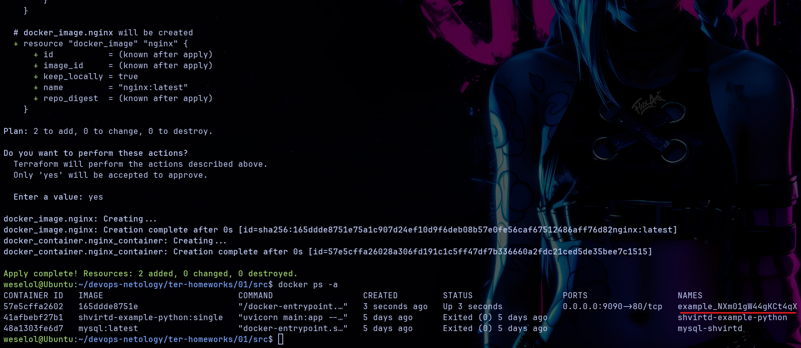

6. Имя контейнера было заменено на `hello_world`: `name  = "hello_world"`. Влаг `-auto-approve` опасен тем, что с ним terraform не запрашивает у пользователя подтверждения выполнения кода, а сразу его применяет. Таким образом, могут быть утеряны данные, удалены сервисы, который были запущены предыдущим кодом.
   Данных флаг может быть полезен для автоматизации процесса запуска сервисов без участия человека, в скриптах запуска.

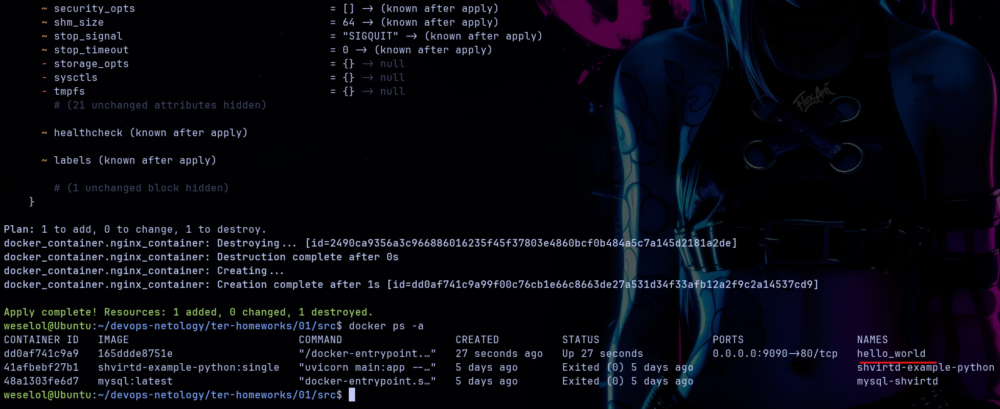

7. Созданные ресурсы были уничтожены командой `terraform destroy`. На скриншоте видно вывод команд `docker ps -a` и `docker images`, подтверждающих, что созданный контейнер был удалён, а образ сохранён.

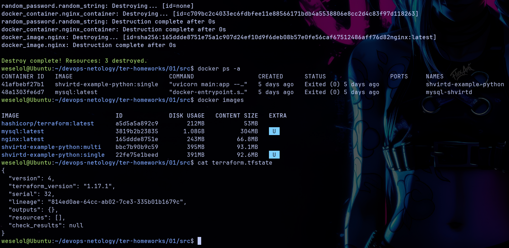

8. Образ `nginx:latest` не был удалён, потому что в атрибутах `resource "docker_image" "nginx"` указан атрибут `keep_locally = true`. Когда значение `true`, то terraform не удалит образ после завершения работы ресурсов.

Цитата из документации terraform провайдера docker:

> "keep_locally (Boolean) If true, then the Docker image won't be deleted on destroy operation. If this is false, it will delete the image from the docker local storage on destroy operation."

---

## Дополнительное задание (со звёздочкой\*)

**Настоятельно рекомендуем выполнять все задания со звёздочкой.** Они помогут глубже разобраться в материале.  
Задания со звёздочкой дополнительные, не обязательные к выполнению и никак не повлияют на получение вами зачёта по этому домашнему заданию.

### Задание 2\*

1. Создайте в облаке ВМ. Сделайте это через web-консоль, чтобы не слить по незнанию токен от облака в github(это тема следующей лекции). Если хотите - попробуйте сделать это через terraform, прочитав документацию yandex cloud. Используйте файл `personal.auto.tfvars` и гитигнор или иной, безопасный способ передачи токена!
2. Подключитесь к ВМ по ssh и установите стек docker.
3. Найдите в документации docker provider способ настроить подключение terraform на вашей рабочей станции к remote docker context вашей ВМ через ssh.
4. Используя terraform и remote docker context, скачайте и запустите на вашей ВМ контейнер `mysql:8` на порту `127.0.0.1:3306`, передайте ENV-переменные. Сгенерируйте разные пароли через random*password и передайте их в контейнер, используя интерполяцию из примера с nginx.(```name = "example*${random_password.random_string.result}"``` , двойные кавычки и фигурные скобки обязательны!)

```
    environment:
      - "MYSQL_ROOT_PASSWORD=${...}"
      - MYSQL_DATABASE=wordpress
      - MYSQL_USER=wordpress
      - "MYSQL_PASSWORD=${...}"
      - MYSQL_ROOT_HOST="%"
```

6. Зайдите на вашу ВМ , подключитесь к контейнеру и проверьте наличие секретных env-переменных с помощью команды `env`. Запишите ваш финальный код в репозиторий.

### Решение

1. Через графический интерфейс создал новую ВМ с ос `Ubuntu 24.04.5 LTS` с названием `terraform-vm`.
2. Подключился по ssh и установил docker согласно документации https://docs.docker.com/engine/install/ubuntu/
3. На локальной ВМ настроил docker context.

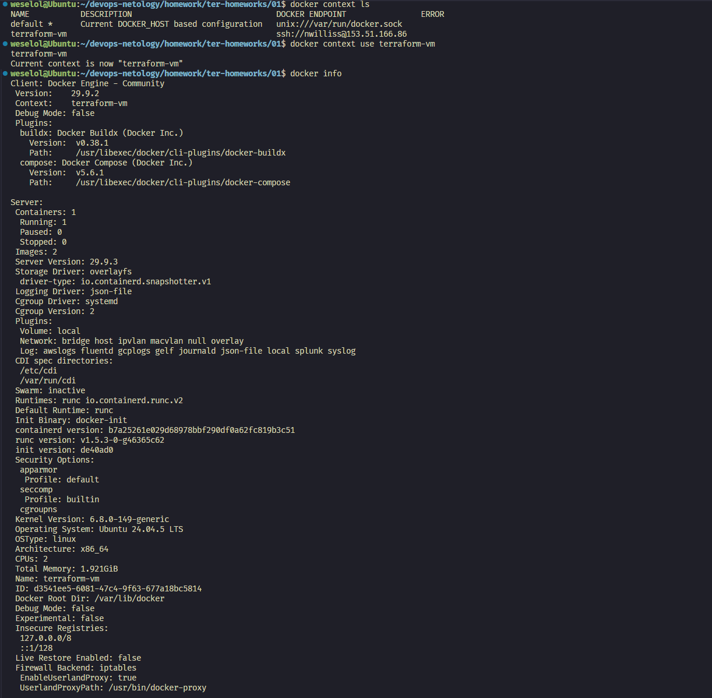

4. Написал `main.tf` (расположен в папке `task_2`), с подключением remote docker context и запуском контейнера `mysql` из образа `mysql:8` на пору `3306`. Сгенерированы 2 пароля: `root_password` и `password` для `MYSQL_ROOT_PASSWORD` и `MYSQL_PASSWORD` соответсвенно. Необходимые env переменные переданы в контейнер через аргумент `env = [...]`.
5. пунтка нет
6. Подключился по ssh к удалёной ВМ Yandex Cloude. Проверил наличие запущенного контейнера `mysql`, подключился к нему и проверил наличие ENV переменных.

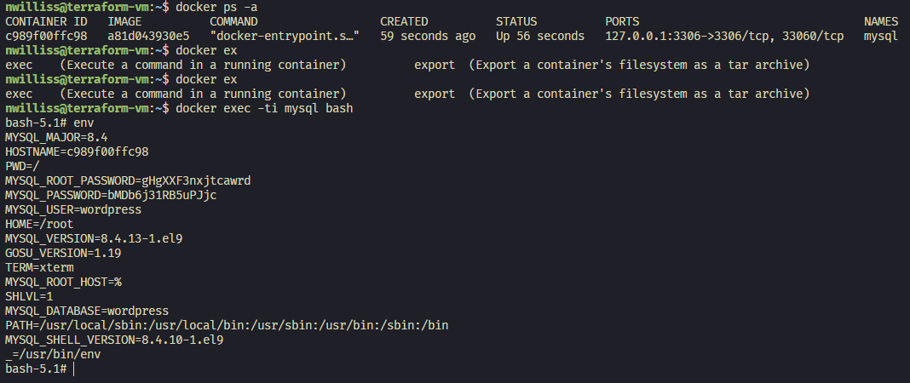


### Задание 3\*

1. Установите [opentofu](https://opentofu.org/)(fork terraform с лицензией Mozilla Public License, version 2.0) любой версии
2. Попробуйте выполнить тот же код с помощью `tofu apply`, а не terraform apply.

### Решение

1. На локальную ВМ был утсановлен `tofu` согласно документации https://opentofu.org/docs/intro/install/deb/

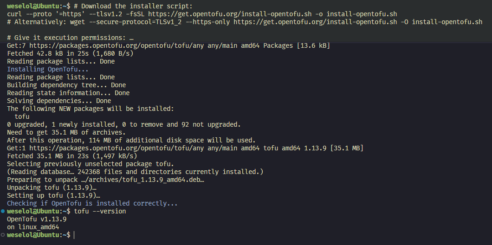

2. Перед использованием `tofu init` в домашней директории пользователя был создан файл `.tofurc` с указанием зеркала реестра для `tofu`. Выл выполнен `tofu init` 1 задания ДЗ.

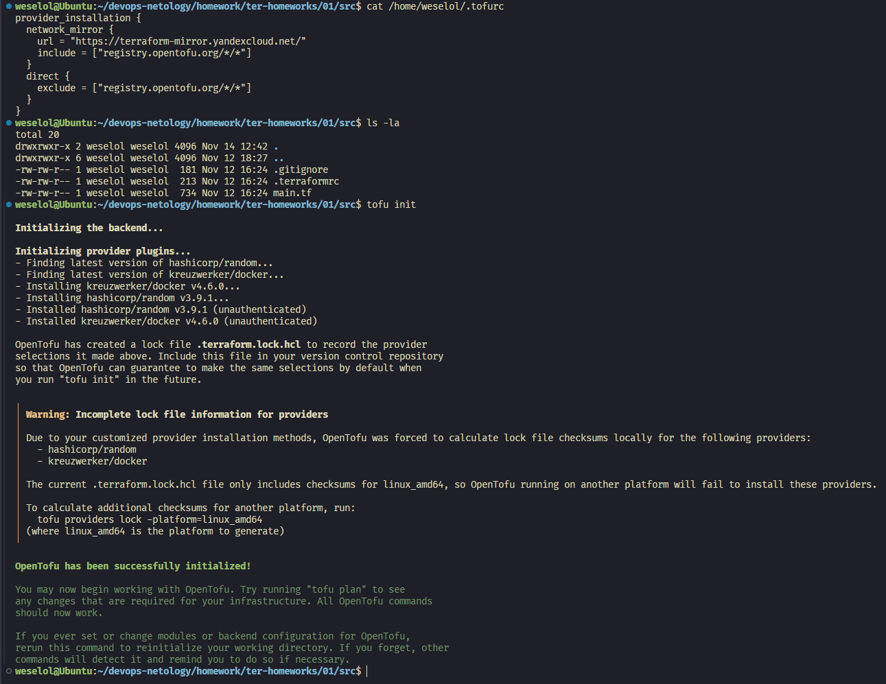

Перед выполнение `tofu apply` 1 задания ДЗ были удалены все контейнеры. Полсе выполнения команды, видно, что появился контейнер `mysql`, как и при `terraform apply`.

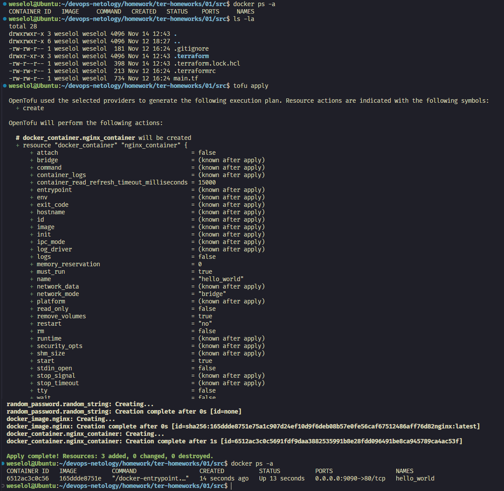

Для 2 задания ДЗ было проделанно тоже самое. Снчала `tofu init`.

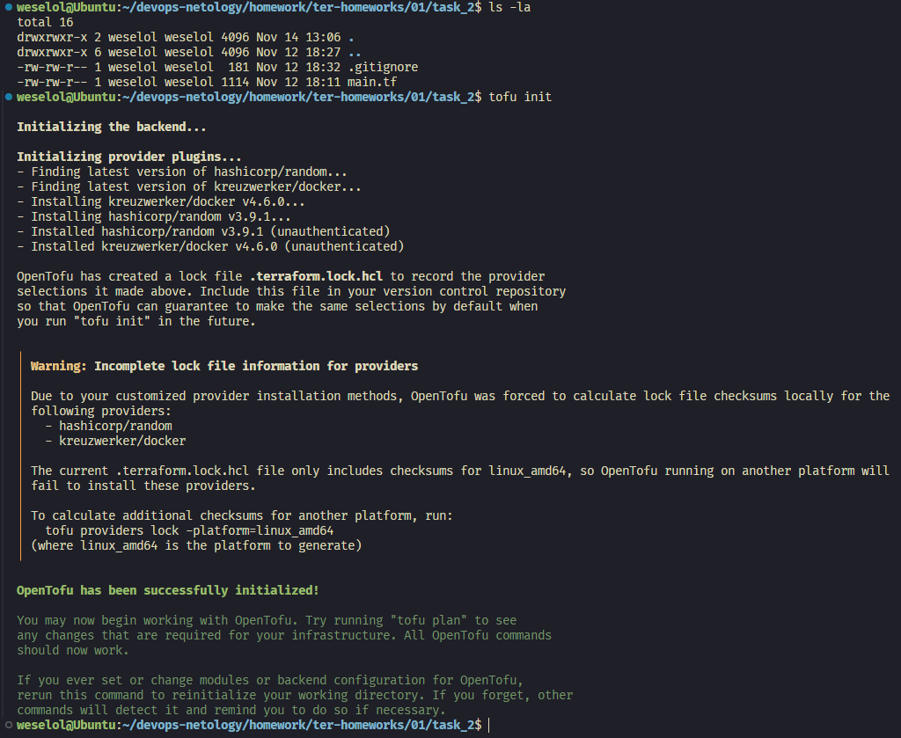

Затем `tofu apply` с настроенным remote docker context.

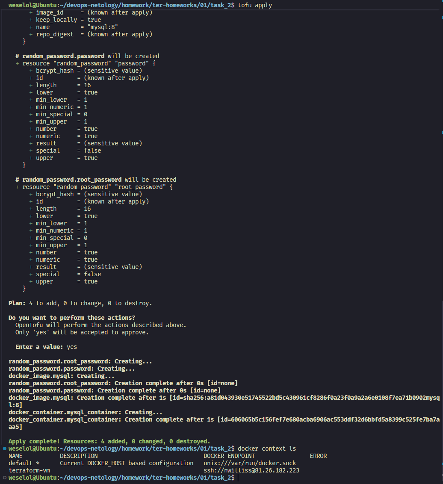

Подключившись к созданной `terraform-vm` в ВМ Yandex Cloud, было проверено наличие контейнера `mysql`. Затем подключившись к контейнеру `mysql`, было проверено наличие переданных ENV переменных.

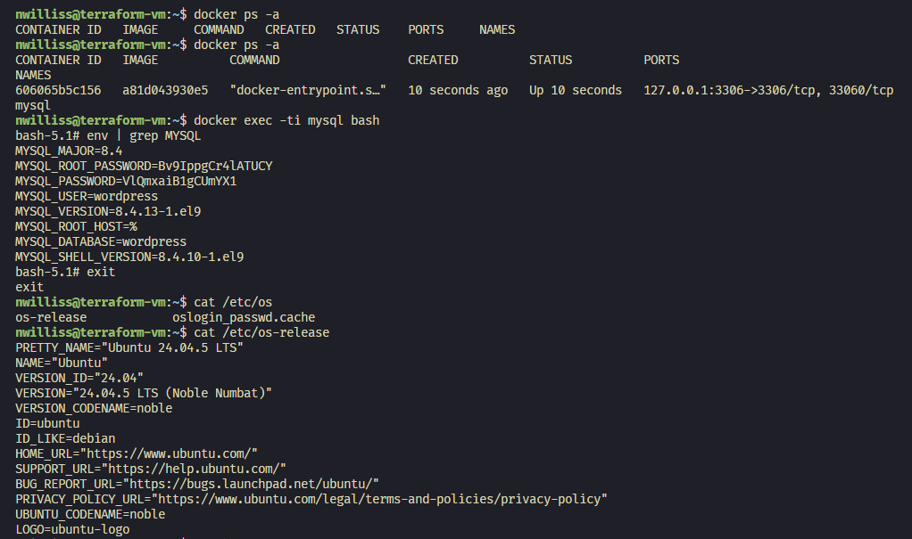

После выполнения `tofu destroy`, контейнер на удалённой ВМ был удалён.

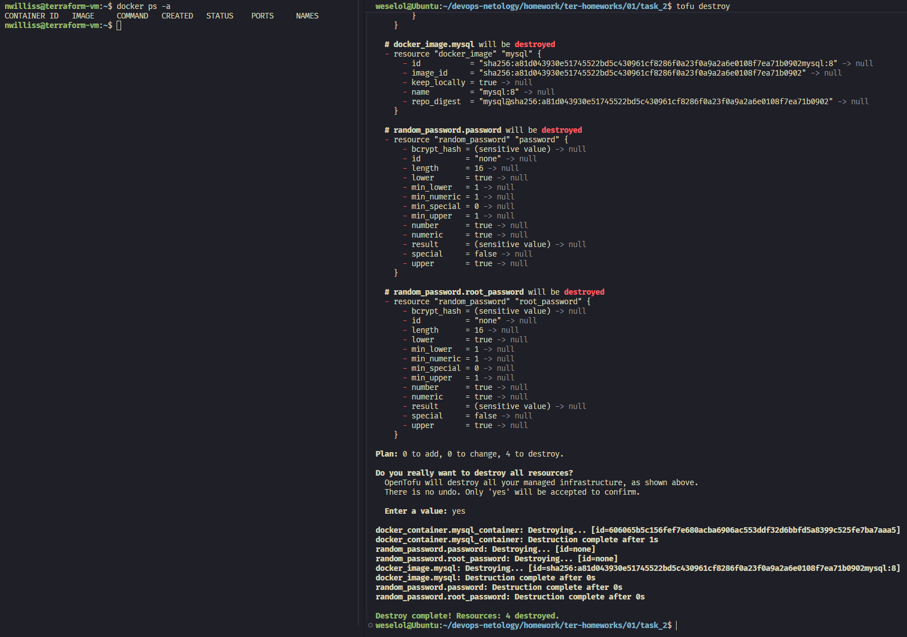


На данном этапе не было выявлено отличие между программами `terraform` и `tofu`

---

### Правила приёма работы

Домашняя работа оформляется в отдельном GitHub-репозитории в файле README.md.  
Выполненное домашнее задание пришлите ссылкой на .md-файл в вашем репозитории.

### Критерии оценки

Зачёт ставится, если:

- выполнены все задания,
- ответы даны в развёрнутой форме,
- приложены соответствующие скриншоты и файлы проекта,
- в выполненных заданиях нет противоречий и нарушения логики.

На доработку работу отправят, если:

- задание выполнено частично или не выполнено вообще,
- в логике выполнения заданий есть противоречия и существенные недостатки.
